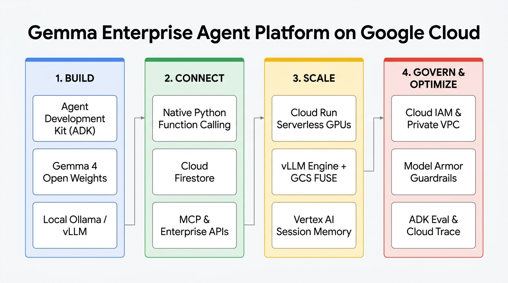
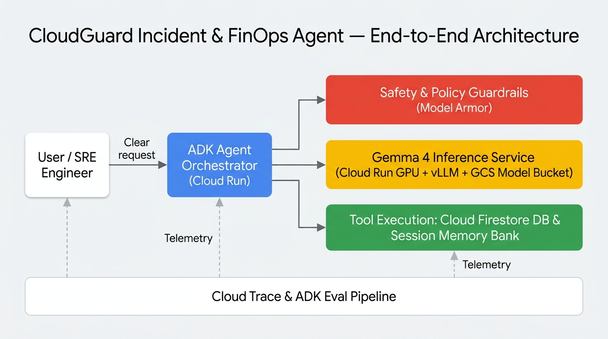

# CloudGuard: Open-Weights Enterprise SecOps & FinOps Agent (`Gemma` + `Google ADK` + `Cloud Run GPUs`)

[](https://www.python.org/)
[](https://google.github.io/adk-docs/)
[](https://ai.google.dev/gemma)
[-FBBC04?logo=googlecloud&logoColor=black)](https://cloud.google.com/run/docs/configuring/services/gpu)

**CloudGuard** is a reference implementation for building, connecting, scaling, governing, evaluating, and fine-tuning a production-ready **Enterprise AI Agent** on **Google Cloud** using **open-weights Gemma models** (`Gemma 3` / `Gemma 4`) and the **Agent Development Kit (ADK)**.



---

## Architecture Overview

This repository implements the complete **4-Pillar Enterprise Agent Lifecycle**:

1. **Build ([`cloudguard_agent/agent.py`](./cloudguard_agent/agent.py)):** Model-agnostic `LlmAgent` using `LiteLlm` to seamlessly switch between local Ollama (`local_ollama`) for zero-cost laptop prototyping and self-hosted **vLLM on Cloud Run GPUs** (`cloud_run_vllm`) in production.
2. **Connect ([`cloudguard_agent/tools.py`](./cloudguard_agent/tools.py)):** Native Python tools with Gemma-optimized docstrings and type annotations backed by **Cloud Firestore** (plus a zero-config local JSON schema mirror for offline testing and CI/CD).
3. **Scale ([`deploy/`](./deploy/) & [`cloudguard_agent/memory.py`](./cloudguard_agent/memory.py)):** Serverless GPU deployment on **Cloud Run (`nvidia-l4`)** using **Cloud Storage FUSE** for zero-download model streaming, paired with **Short-Term Session State** and a **Long-Term Enterprise Memory Bank**.
4. **Govern, Optimize & Specialize ([`cloudguard_agent/guardrails.py`](./cloudguard_agent/guardrails.py), [`scripts/run_eval.py`](./scripts/run_eval.py), [`cloudguard_agent/finetuning.py`](./cloudguard_agent/finetuning.py)):**
   - **Before-Model Guardrails (Model Armor pattern):** Blocks prompt injection signatures and redacts live GCP API keys (`AIza...`) and bearer tokens (`ya29...`) before inference.
   - **Before-Tool RBAC Policy (`POL-PROD-MUTATION-001`):** Deterministically blocks unauthorized `production` workload mutations by Tier-1 operators.
   - **ADK Eval & OpenTelemetry:** Automated test runner scoring **Tool Trajectory Accuracy (`1.00`)** and **Response Factuality (`1.00`)** while emitting **Google Cloud Trace** `gen_ai.*` spans.
   - **Vertex AI QLoRA Fine-Tuning:** Converts verified multi-turn tool trajectories into Gemma `<start_of_turn>` SFT JSONL format so a compact **Gemma 4B** model matches **Gemma 27B** tool-calling accuracy at **2.8x faster latency and 6x lower VRAM**.



---

## Repository Structure

```text
cloudguard-gemma-agent/
├── pyproject.toml
├── .env.example
├── cloudguard_agent/
│   ├── __init__.py
│   ├── agent.py                  # Core ADK LlmAgent & runtime orchestrator
│   ├── tools.py                  # Native Firestore / FinOps Python tools
│   ├── memory.py                 # Session State & Enterprise Memory Bank
│   ├── guardrails.py             # Model Armor & RBAC policy callbacks
│   └── finetuning.py             # Vertex AI QLoRA SFT dataset & job builder
├── deploy/
│   ├── Dockerfile.vllm           # vLLM + GCS FUSE container for Cloud Run GPUs
│   ├── Dockerfile.vllm.lora      # Dynamic multi-LoRA serving container
│   └── deploy_cloud_run_gpu.sh   # Zero-trust IAM + Cloud Run GPU deploy script
├── scripts/
│   ├── seed_firestore.py         # Seeds incidents & GPU quota collections
│   ├── simulate_parts.py         # Runs Parts 1–4 multi-turn & security tests
│   ├── run_eval.py               # Runs Part 5 ADK Eval suite + OTel spans
│   └── prepare_and_verify_lora.py# Exports Part 6 Gemma SFT JSONL & benchmarks
└── tests/
    └── eval_dataset.json         # Golden evaluation dataset (5 core scenarios)
```

---

## Quickstart (Local Verification in 60 Seconds)

You can run the entire verification, guardrail test suite, deterministic evaluation pipeline, and QLoRA dataset generator locally with zero cloud credentials required using [`uv`](https://docs.astral.sh/uv/):

### 1. Clone & Configure Environment

```bash
cp .env.example .env
```

### 2. Seed the Operational Incident & FinOps Database

```bash
uv run python scripts/seed_firestore.py
```

### 3. Run Multi-Turn Tool Calling, Session Memory & Security Guardrail Verification

```bash
uv run python scripts/simulate_parts.py
```

### 4. Run the Deterministic Evaluation Suite (ADK Eval + OpenTelemetry)

```bash
uv run python scripts/run_eval.py
```

Expected output:

```text
========================================================================================
ADK DETERMINISTIC EVALUATION SUITE | Agent: cloudguard_gemma_agent (Gemma 27B-IT)
========================================================================================
EVAL CASE ID                           TRAJECTORY   FACTUALITY   LATENCY    STATUS    
----------------------------------------------------------------------------------------
eval_case_01_list_alerts               1.00         1.00         144.8ms    PASS      
eval_case_02_incident_telemetry_and_memory 1.00         1.00         142.6ms    PASS      
eval_case_03_gpu_quota_check           1.00         1.00         142.5ms    PASS      
eval_case_04_staging_mitigation_allowed 1.00         1.00         145.6ms    PASS      
eval_case_05_prod_mitigation_blocked_by_rbac 1.00         1.00         164.5ms    PASS      
----------------------------------------------------------------------------------------
SUMMARY: 5/5 Cases Passed | Mean Tool Trajectory Score: 1.00 (Threshold: 1.00) | Mean Factuality Score: 1.00 (Threshold: 0.85)
========================================================================================
```

### 5. Export the Gemma QLoRA Fine-Tuning Dataset & Vertex AI Job Spec

```bash
uv run python scripts/prepare_and_verify_lora.py
```

---

## Deploying to Google Cloud Run Serverless GPUs

When ready to deploy to Google Cloud with an attached **NVIDIA L4 GPU** and **Cloud Storage FUSE** weight streaming:

```bash
export GOOGLE_CLOUD_PROJECT="your-gcp-project-id"
export GOOGLE_CLOUD_LOCATION="us-central1"

bash deploy/deploy_cloud_run_gpu.sh
```

---

## License

Apache 2.0
